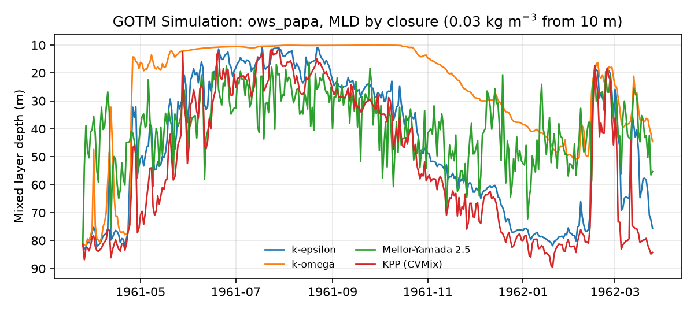
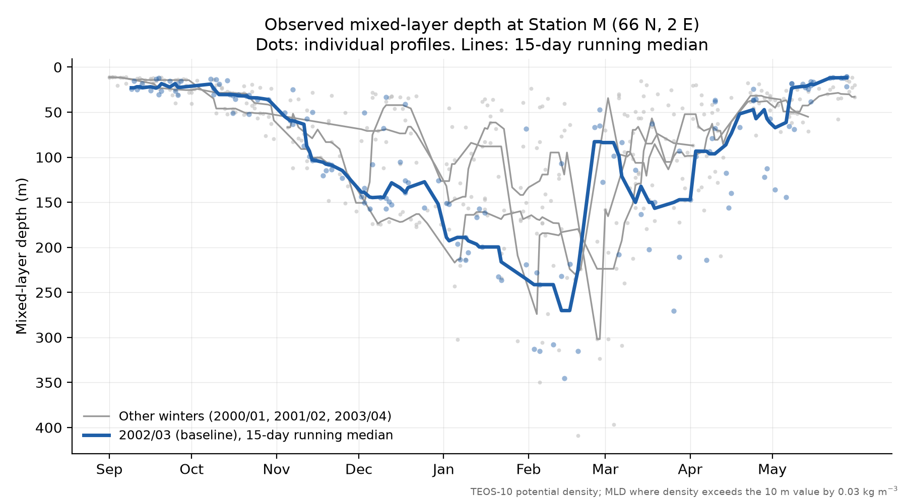

# Winter mixed-layer deepening at Ocean Weather Station M

An independent single-column modelling study of winter mixed-layer deepening at Ocean Weather Station M in the Norwegian Sea, using the General Ocean Turbulence Model (GOTM). The study compares four turbulence closures against observations, with verification, validation and error estimation.

**Status:** in progress. Steps 1 to 3 were completed on 20 November 2026, and Steps 4 and 5 on 26 November 2026. Results are added below as each stage is completed.

## Scientific question

How well does a one-dimensional ocean turbulence model reproduce winter mixed-layer deepening at Station M, and how much does the answer depend on the choice of turbulence closure?

## Motivation

Winter mixing in the Nordic Seas links air-sea heat loss to the formation of dense water, which feeds the deep circulation of the North Atlantic. Weather and climate models represent this vertical mixing through parameterisations, and different closures can give different mixed-layer depths under the same surface forcing. Station M offers a long observational record at a single location, which makes it a suitable site for testing these closures against measurements.

## Study design

| Item | Choice |
|---|---|
| Site | Ocean Weather Station M, 66°N, 2°E, Norwegian Sea |
| Model | GOTM v6.0.8, built with CVMix |
| Turbulence closures | k-ε, k-ω, Mellor-Yamada 2.5, KPP |
| Surface forcing | ERA5 hourly heat and momentum fluxes, prescribed (freshwater flux not yet included) |
| Observations | OceanSITES Station M temperature and salinity profiles (1948 to 2009) |
| Period | One baseline winter, September to May, chosen from the observations |
| Mixed-layer depth criterion | Density increase of 0.03 kg m⁻³ from the 10 m value |
| Density | TEOS-10 (`gsw` package), applied identically to model output and observations |

## Plan and progress

1. Set up this repository (done, 20 November 2026)
2. Build GOTM v6.0.8 with CVMix (done, 20 November 2026)
3. Run the GOTM test cases and compare the four closures at Ocean Weather Station Papa (done, 20 November 2026)
4. Download the Station M observations (done, 26 November 2026)
5. Calculate the observed winter mixed-layer depth and choose the baseline winter (done, 26 November 2026)
6. Run GOTM at Station M with ERA5 forcing (Figure 1: model against observations)
7. Grid convergence test (Figure 2)
8. Verify the KPP and k-ω configurations
9. Run the experiments: four closures, three vertical resolutions and three forcing strengths, with an analysis of variance to attribute the spread
10. Write the report

## Results so far

### Step 3: four closures at Ocean Weather Station Papa (1961 to 1962)
- All four closures ran successfully under identical forcing.
- k-ε and KPP agree closely for most of the year: about 80 m in late winter and 10 to 25 m in summer.
- Mellor-Yamada 2.5 is noisier and shallower in winter (mostly 40 to 60 m).
- k-ω stays near 10 m from June to October; this will be checked in Step 8 before its results are used.



### Step 5: observed winter mixed layer at Station M
- **Data:** OceanSITES Station M CTD record, 1948 to 2009, using only measurements where both temperature and salinity are flagged as good (105,018 of 114,951 records).
- **Method:** TEOS-10 potential density (gsw); the mixed-layer depth is where density first exceeds its 10 m value by 0.03 kg m⁻³, interpolated between sampling levels.
- **Baseline winter:** September 2002 to May 2003, chosen for its vertical resolution (10 sampling levels in the top 500 m) and regular sampling (no gap longer than 21 days).
- **Result:** the typical mixed layer deepens from about 20 m in September to about 240 to 270 m in mid-February, then restratifies to 10 to 20 m by late May. The deepest single profile reached 345 m on 14 February 2003.
- **Next:** ERA5 surface forcing for the baseline winter is being downloaded for the first Station M model run.



## Planned repository structure

```
README.md            this file
SETUP.md             build instructions and configuration notes
scripts/
  run_closures.py        runs a GOTM case with each of the four closures
  mld.py                 mixed-layer depth, same criterion for model and observations
  plot_closures.py       plots mixed-layer depth for each closure
  era5_download.py       downloads ERA5 hourly fluxes at 66°N, 2°E for one winter
  era5_to_gotm.py        converts ERA5 output into GOTM flux files
  inspect_station_m.py   summarises the Station M files (records, profiles, depths, quality flags)
  winter_coverage.py     counts usable profiles in each winter to choose the baseline winter
  observed_mld.py        observed mixed-layer depth and the winter comparison figure
config/              GOTM configuration for Station M
figures/             figures produced by the study
data/raw/            observations and forcing (not tracked; see SETUP.md)
```

## How to reproduce

1. Build GOTM and install the Python packages as described in `SETUP.md`.
2. Download the Station M observations into `data/raw/`.
3. Download and convert the ERA5 forcing with the two `era5_` scripts.
4. Run the closures with `scripts/run_closures.py` and plot them with `scripts/plot_closures.py`.
5. Calculate the observed mixed-layer depth and plot the winters with `scripts/observed_mld.py`.

Raw data files are not stored in this repository. They are downloaded from their original providers.

## Known limitations

- A single-column model has no lateral advection, so heat and salt carried by currents are missing.
- The surface forcing comes from a reanalysis and carries its own uncertainty.
- Results at one site and for one winter may not hold elsewhere.

## Use of AI assistance

The initial study plan and starter scripts were drafted with the help of an AI assistant (Claude, Anthropic). I run, test, adapt and document all code and results in this repository myself, and each script records any changes I make to it.

## Credits and references

- GOTM: https://gotm.net and https://github.com/gotm-model/code
- Station M observations: OceanSITES, https://www.ncei.noaa.gov/data/oceans/ndbc/oceansites/DATA/STATION-M/
- ERA5: Hersbach, H. et al. (2020). The ERA5 global reanalysis. *Quarterly Journal of the Royal Meteorological Society*, 146, 1999–2049.
- Umlauf, L. and Burchard, H. (2005). Second-order turbulence closure models for geophysical boundary layers. *Continental Shelf Research*, 25, 795–827.
- Umlauf, L., Burchard, H. and Hutter, K. (2003). Extending the k–ω turbulence model towards oceanic applications. *Ocean Modelling*, 5, 195–218.
- Mellor, G. L. and Yamada, T. (1982). Development of a turbulence closure model for geophysical fluid problems. *Reviews of Geophysics and Space Physics*, 20, 851–875.
- Large, W. G., McWilliams, J. C. and Doney, S. C. (1994). Oceanic vertical mixing: a review and a model with a nonlocal boundary layer parameterization. *Reviews of Geophysics*, 32, 363–403.
- TEOS-10: IOC, SCOR and IAPSO (2010). *The international thermodynamic equation of seawater 2010*. https://www.teos-10.org

## Author

Baby Chandrika Shanmugam
